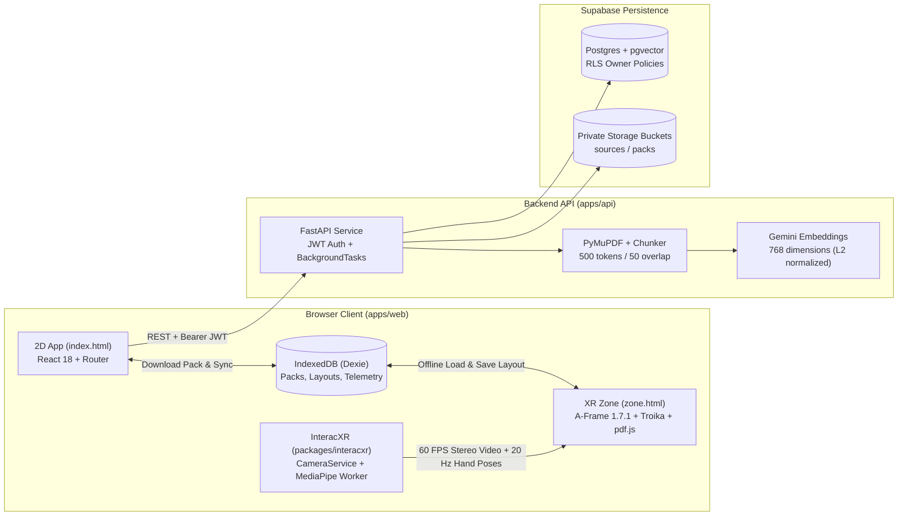

# IMAGGINAI

**Language:** English | [Português (Brasil)](docs/README.pt-BR.md)

**Additional documentation:** [System Architecture](docs/ARCHITECTURE.md) | [Contributing and Implementation Standards](docs/CONTRIBUTING.md)

IMAGGINAI (_IMAGGI Navigable Augmented Intelligence_) is a low-cost hybrid WebXR (VR/AR) study environment designed to run on a smartphone browser mounted inside a passive headset (VRBox or Google Cardboard). It combines head-gaze aiming, rear-camera 3D hand tracking powered by our internal library (`interacxr`), and an offline spatial workspace where students interact with AI-grounded study materials.

---

## 1. System Overview

The platform is divided into three operational stages with strict boundaries between online AI preparation and offline spatial study:

| Stage       | Environment                                       | Purpose                                                                                                                                                                | Network & AI Usage                                                         |
| :---------- | :------------------------------------------------ | :--------------------------------------------------------------------------------------------------------------------------------------------------------------------- | :------------------------------------------------------------------------- |
| **Prepare** | 2D Web App (`index.html`, React 18)               | Create study Zones, upload PDFs, trigger background ingestion and Study Pack generation, review extracted concepts.                                                    | Online (FastAPI, Supabase, Gemini, Groq)                                   |
| **Zone**    | 3D Spatial Workspace (`zone.html`, A-Frame 1.7.1) | Immersive study session with interactive reveal/hide 3D flashcards, multi-page PDF reader, 3D concept graphs, Pomodoro timer, and stereo camera passthrough.           | 100% Offline (reads from IndexedDB via Dexie; zero LLM or network calls)   |
| **Review**  | 2D Web App (`/dashboard`, React 18)               | Dual-lens **Student & Education Researcher Dashboard** (focus time, concept coverage, quiz accuracy, pinch biomechanics, JSON/CSV research export, and LGPD controls). | Local-first (syncs aggregated metrics only if research consent is enabled) |



---

## 2. Technology Stack

| Layer                             | Technology                                                        | Role in the Project                                                                                                                |
| :-------------------------------- | :---------------------------------------------------------------- | :--------------------------------------------------------------------------------------------------------------------------------- |
| **Monorepo & Package Management** | `pnpm` (v10) + `uv` (Python 3.12)                                 | Workspace orchestration across TypeScript packages and the Python backend.                                                         |
| **2D Web Application**            | Vite 8, React 18, React Router 7, TypeScript 6 (`strict`)         | Preparation, authentication, PDF upload monitoring, and performance review.                                                        |
| **XR Spatial Workspace**          | A-Frame 1.7.1 (Three.js r173), `aframe-troika-text`, `pdfjs-dist` | WebXR stereo rendering, SDF typography, sliding-window PDF canvas textures, and custom 3D rounded glass geometry.                  |
| **Hand Tracking & Passthrough**   | `interacxr`, `@mediapipe/tasks-vision` (1.1.0)                    | Single-stream rear camera acquisition, Web Worker hand landmark inference, One Euro filtering, and stereo passthrough shaders.     |
| **Client Persistence**            | Dexie 4 (IndexedDB)                                               | Offline storage for Study Packs, spherical panel layouts, Pomodoro session state, and local telemetry events.                      |
| **Backend API**                   | FastAPI, Pydantic v2, `pydantic-settings`, `PyJWT`                | Stateless REST endpoints, Supabase JWT verification, and background ingestion jobs.                                                |
| **PDF & AI Pipeline**             | `pymupdf`, `google-genai`, Groq, `networkx`                       | Per-page text extraction, anchored chunking, 768-dimension vector embeddings, grounded Study Pack generation, and 3D graph layout. |
| **Database & Storage**            | Supabase (PostgreSQL, `pgvector` HNSW, Storage, Auth)             | Row-Level Security (RLS) multi-tenant storage for zones, sources, vector chunks, packs, jobs, and session aggregates.              |
| **Quality & Testing**             | Vitest, Pytest, ESLint 10, Prettier, Ruff                         | Unit, replay, schema parity, and mocked integration test suites.                                                                   |

---

## 3. Repository Structure

```text
imagginai/
├─ apps/
│  ├─ web/                        # Multi-page Vite application
│  │  ├─ index.html               # 2D entry point (Prepare / Review)
│  │  ├─ zone.html                # 3D WebXR entry point (plain A-Frame, no React)
│  │  ├─ public/mediapipe/        # Self-hosted MediaPipe WASM and hand_landmarker.task
│  │  └─ src/
│  │     ├─ app/                  # React pages, components, and glass-theme styles
│  │     ├─ zone/                 # A-Frame components (imx-*) and pure spatial systems
│  │     └─ shared/               # StudyPack validator, Dexie database, i18n (pt-BR), logger
│  └─ api/                        # FastAPI backend managed by uv
│     ├─ app/
│     │  ├─ core/                 # Settings (config.py), JWT auth (auth.py), store abstraction (db.py)
│     │  ├─ routers/              # REST endpoints (/health, /zones, /jobs)
│     │  ├─ schemas/              # Pydantic models (study_pack.py, zones.py, jobs.py)
│     │  └─ services/             # PyMuPDF ingestion, 768-dim embeddings, background jobs
│     ├─ scripts/run-uv.mjs       # Cross-platform uv executable locator
│     └─ tests/                   # Pytest suite with mocked providers and InMemoryStore
├─ packages/
│  └─ interacxr/                  # Internal WebXR hand-tracking and passthrough library
│     ├─ src/
│     │  ├─ core/                 # CameraService, HandTracker, OneEuroFilter, PoseClassifier
│     │  ├─ calibration/          # Unified FOV calibration profile
│     │  ├─ passthrough/          # Head-locked stereo video plane and 5-tap blur shader
│     │  ├─ telemetry/            # Typed TelemetryBus
│     │  ├─ replay/               # Landmark session recorder and deterministic replay player
│     │  └─ aframe/               # A-Frame component adapters (ixr-*)
│     └─ examples/basic/          # Standalone Vite regression example
├─ fixtures/
│  ├─ demo-pack.json              # Reference StudyPack (cardiovascular system, pt-BR)
│  ├─ study-pack-invalid-cases.json # 27 cross-language invalid test cases (TS + Python parity)
│  └─ landmark-sessions/          # Synthetic and real-device recorded hand landmark sessions
├─ supabase/migrations/
│  └─ 0001_init.sql               # PostgreSQL schema, pgvector HNSW index, RLS, and Storage policies
└─ docs/
   ├─ ARCHITECTURE.md             # Deep-dive technical architecture and data flows
   ├─ CONTRIBUTING.md             # Code conventions and implementation examples
   └─ README.pt-BR.md             # Portuguese version of this README
```

---

## 4. Local Development Setup

### Prerequisites

- **Node.js** 22+ and **pnpm** 10+
- **Python** 3.11 or 3.12 and **uv**

### 1. Install Dependencies

```bash
# Install JavaScript/TypeScript workspace packages
pnpm install

# Install Python virtual environment and dependencies
cd apps/api && uv sync && cd ../..
```

### 2. Configure Environment Variables

Copy `.env.example` to `.env` at the repository root and fill in your credentials:

```bash
cp .env.example .env
```

| Variable                    | Scope | Description                                                                  |
| :-------------------------- | :---- | :--------------------------------------------------------------------------- |
| `SUPABASE_URL`              | API   | Project URL from Supabase Settings -> Data API (`https://<id>.supabase.co`). |
| `SUPABASE_SERVICE_ROLE_KEY` | API   | Secret `service_role` key from Supabase Settings -> API Keys (backend only). |
| `SUPABASE_JWT_SECRET`       | API   | JWT signing secret from Supabase Settings -> JWT Keys.                       |
| `GEMINI_API_KEY`            | API   | Google AI Studio API key used for embeddings and Study Pack extraction.      |
| `EMBEDDING_MODEL`           | API   | Gemini embedding model identifier (e.g., `gemini-embedding-001`).            |
| `LLM_MODEL`                 | API   | Primary Gemini generation model (e.g., `gemini-2.5-flash`).                  |
| `GROQ_API_KEY`              | API   | Fallback LLM API key from Groq Console (used in Phase 7+).                   |
| `FALLBACK_LLM_MODEL`        | API   | Fallback model identifier (e.g., `llama-3.3-70b-versatile`).                 |
| `CORS_ORIGINS`              | API   | Comma-separated allowed origins (default: `http://localhost:5173`).          |
| `VITE_SUPABASE_URL`         | Web   | Same Supabase Project URL exposed to the browser client.                     |
| `VITE_SUPABASE_ANON_KEY`    | Web   | Public `anon` key from Supabase Settings -> API Keys.                        |
| `VITE_API_BASE_URL`         | Web   | Base URL of the FastAPI server (default: `http://localhost:8000`).           |

To initialize the database schema, open the Supabase SQL Editor, paste the contents of [`supabase/migrations/0001_init.sql`](supabase/migrations/0001_init.sql), and run the query.

### 3. Common Commands

| Command          | Description                                                                                                  |
| :--------------- | :----------------------------------------------------------------------------------------------------------- |
| `pnpm dev`       | Starts the Vite dev server on `http://localhost:5173` (`/index.html` and `/zone.html`).                      |
| `pnpm dev:https` | Starts the Vite dev server over HTTPS (`https://<lan-ip>:5173`) for smartphone WebXR testing.                |
| `pnpm dev:api`   | Starts the FastAPI server on `http://localhost:8000` (Swagger UI at `/docs`).                                |
| `pnpm lint`      | Runs ESLint, Prettier check, TypeScript typecheck (`tsc`), and Python Ruff check/format.                     |
| `pnpm test`      | Runs all automated tests across `packages/interacxr` (Vitest), `apps/web` (Vitest), and `apps/api` (Pytest). |
| `pnpm build`     | Builds `interacxr`, compiles `apps/web` production bundles, and verifies Python bytecode compilation.        |

> **Note:** All automated tests (`pnpm test`) mock external providers and run deterministically without requiring live credentials in `.env`.

---

## 5. Cloud Deployment (Free Tier)

The repository includes ready-to-use deployment configurations for zero-cost cloud hosting:

- **Frontend (`vercel.json`):** Connect the GitHub repository to Vercel (Root Directory: `.`). Vercel runs `pnpm --filter @imagginai/web build`, serves `apps/web/dist` over HTTPS (required for WebXR and camera permissions), caches `/mediapipe/*` and `/pdfjs/*` immutably, and routes 2D SPA paths (`/`, `/zones/:id`, `/dashboard`) to `/index.html` while keeping `/zone.html` standalone.
- **Backend API (`apps/api/Dockerfile` & `render.yaml`):** Connect the repository to Render Blueprints (or deploy `apps/api/Dockerfile` directly). Set `SUPABASE_URL`, `SUPABASE_SERVICE_ROLE_KEY`, `SUPABASE_JWT_SECRET`, `GEMINI_API_KEY`, `GROQ_API_KEY`, and `CORS_ORIGINS` in the Render environment dashboard.
- **Supabase Keep-Alive (`.github/workflows/supabase-keepalive.yml`):** Automated GitHub Action running every 5 days (`0 8 */5 * *`) to prevent Supabase Free Tier project pausing. Add `SUPABASE_URL` and `SUPABASE_ANON_KEY` to your GitHub Repository Secrets.

---

## 6. Coding Standards Summary

This repository enforces strict code conventions across TypeScript and Python (detailed with full examples in [`docs/CONTRIBUTING.md`](docs/CONTRIBUTING.md)):

- **English Identifiers:** All variables, functions, classes, types, files, and directories must be written in English (`kebab-case` for files, `PascalCase` for classes/types, `camelCase` in TypeScript, `snake_case` in Python, `UPPER_SNAKE_CASE` for constants).
- **Lowercase Impersonal Portuguese Comments:** Every comment, JSDoc, and Python docstring must be written in Portuguese, using exclusively lowercase letters (including the first character) and impersonal verb forms (passive voice or third person, e.g., `// calcula a posição esférica do painel`, `# valida a assinatura do token jwt`). First-person or second-person phrasing is strictly prohibited.
- **Pure Logic Separation:** Core math, state machines, and data transformations must be isolated in pure modules without DOM, A-Frame, or network imports so they can be unit-tested directly.
- **No Magic Numbers:** Spatial, timing, schema, and API limits must be defined in [`apps/web/src/zone/config/constants.ts`](apps/web/src/zone/config/constants.ts) and [`apps/api/app/core/config.py`](apps/api/app/core/config.py).

---

## 7. License

This project and the internal `interacxr` package are licensed under the MIT License. See [`packages/interacxr/LICENSE`](packages/interacxr/LICENSE) for details.
