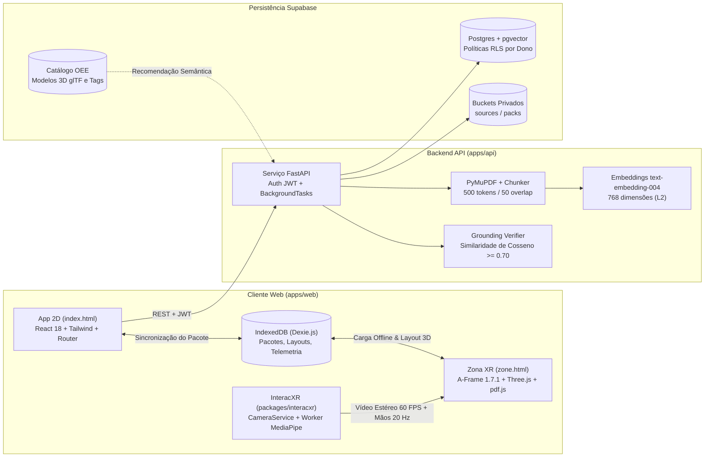

<p align="center">
  
</p>

# IMAGGINAI

**Idioma:** Português (Brasil) | [English](docs/README.en.md)

**Documentação complementar:** [Arquitetura do Sistema](docs/ARCHITECTURE.md) | [Guia de Contribuição e Padrões de Código](docs/CONTRIBUTING.md)

O **IMAGGINAI** (*IMAGGI Navigable Augmented Intelligence*) é um ecossistema educacional imersivo em WebXR (VR/AR) de baixo custo, projetado para executar no navegador de smartphones acoplados a visores passivos (VRBox ou Google Cardboard). O projeto transforma materiais de estudo estáticos (livros, apostilas e artigos em PDF) em ambientes tridimensionais interativos com **RAG Espacial**, biblioteca proprietária de rastreamento de mãos por visão computacional na câmera traseira (**InteracXR**), **Objetos de Estudo Especiais (OEE)** tridimensionais ancorados ao texto original e coleta ética de telemetria comportamental para auxílio pedagógico universitário.

---

## 1. Visão Geral do Sistema (Os Três Tempos)

A arquitetura do IMAGGINAI opera em três fases funcionais coordenadas, com fronteiras rigorosas entre o processamento em nuvem e a imersão espacial:

| Estágio | Ambiente | Objetivo Pedagógico e Tecnológico | Conectividade e IA |
| :--- | :--- | :--- | :--- |
| **1. Preparar** | Web App 2D (`index.html`, React 18) | Criação de Zonas de estudo, envio de PDFs da disciplina, extração de texto, vetorização semântica, recomendação de ativos e validação de grounding contra alucinações. | **Online** (FastAPI, Supabase pgvector, Gemini 1.5 Pro / Groq) |
| **2. Zona** | Espaço Espacial 3D (`zone.html`, A-Frame 1.7.1) | Sessão de estudo imersivo com grafos conceituais 3D, Objetos de Estudo Especiais animados em 360°, flashcards espaciais, quizzes ativos, minigames de ordenação e leitor de PDF sincronizado. | **100% Offline** (carregado localmente via IndexedDB/Dexie; zero chamadas de rede ou LLM) |
| **3. Revisar** | Web App 2D (`/dashboard`, React 18) | **Painel do Estudante e do Pesquisador Docente**: visualização de tempo de permanência em foco vs. passthrough, retenção por conceito, acurácia em quizzes, biomecânica de pinça e exportação de dados anonimizados para aprimoramento curricular na UFC. | **Local-first / LGPD** (envia dados analíticos agregados apenas mediante termo de consentimento explícito) |



---

## 2. Recursos Interativos da Zona 3D

Dentro da Zona imersiva, o estudante encontra cinco tipos de recursos instrucionais gerados e fundamentados no material de estudo:

1. **Objetos de Estudo Especiais (OEE) (`imx-special-study-object`):**
   * Modelos tridimensionais animados em formato glTF 2.0 (ex.: Coração Anatômico em batimento contínuo via `AnimationMixer`).
   * Rotação livre em 360° (Yaw/Pitch) utilizando gestos de pinça (*pinch*) da mão esquerda ou direita via `ixr-rotatable`.
   * Marcadores clínicos espaciais (*hotspots*) com núcleo branco e contorno preto em casco invertido (*BackSide*), com oclusão fisiológica no buffer de profundidade (*Z-buffer*).
   * Cartão flutuante em *billboarding* que acompanha o olhar do estudante e botão **"Ver no PDF ↗"**, que salta instantaneamente o leitor espacial para a página exata da estrutura (`ZONE_GOTO_PDF_PAGE_EVENT`).
   * Estabilidade óptica calibrada para Realidade Mista: camadas explícitas de renderização (`renderOrder`: vídeo passthrough `-100`, modelo 3D `1`, marcadores `2`, card `10`) e estúdio virtual de 3 pontos de luz (Key, Fill e Rim lights).

2. **Grafo de Conceitos 3D (`imx-concept-graph`):**
   * Visualização espacial esférica de nós e arestas direcionadas extraídas pela IA.
   * Seleção por feixe ou pinça que expande painéis de análise profunda e destaca conexões conceituais.

3. **Flashcards Espaciais 3D (`imx-card-panel`):**
   * Cartões flutuantes em estética *glassmorphism* com alternância dinâmica (`Revelar` / `Ocultar`).
   * Navegação direta para a citação original do PDF e reposicionamento livre na esfera ao redor do usuário.

4. **Quizzes Ativos de Retenção (`imx-quiz-panel`):**
   * Questões de múltipla escolha integradas à cena, com 4 alternativas interativas e explicação pedagógica imediata fundamentada no texto.

5. **Minigame de Ordenação Sequencial (`imx-sequence-asset`):**
   * Ordenação cronológica de processos em etapas (ex.: fluxo de despolarização cardíaca, ciclo de Krebs, análise de circuitos).

6. **Belt Menu e Ferramental de Produtividade (`imx-belt-menu`):**
   * Menu acoplado à cintura acionado pelo olhar para baixo com histerese visual para evitar disparos acidentais.
   * Filtros rápidos por tipo de conteúdo, alternância de temas (*dark-glass* e *light-glass*), alternância entre **Foco Isolado (VR)** e **Passthrough (AR)**, timer Pomodoro espacial e recentralização dinâmica de painéis.

---

## 3. Stack Tecnológica

| Camada | Tecnologia | Papel no Projeto |
| :--- | :--- | :--- |
| **Monorepo e Pacotes** | `pnpm` (v10) + `uv` (Python 3.12) | Orquestração de dependências multiplataforma para os workspaces TypeScript e Python. |
| **Aplicação Web 2D** | Vite 8, React 18, React Router 7, Tailwind CSS, TypeScript 6 (`strict`) | Assistente de preparação de zonas, upload de PDFs, revisão de pacotes e dashboard analítico. |
| **Espaço Imersivo WebXR** | A-Frame 1.7.1, Three.js r173, `aframe-troika-text`, `pdfjs-dist` | Renderização WebXR estéreo, tipografia SDF nítida, texturas deslizantes de PDF e geometria 3D de vidro com cantos arredondados. |
| **Visão Computacional & VR** | `interacxr`, `@mediapipe/tasks-vision` (1.1.0) | Captura de stream único de câmera traseira, rastreamento de marcos da mão em Web Worker, OneEuroFilter e passthrough estéreo. |
| **Persistência Local** | Dexie 4 (IndexedDB) | Armazenamento no cliente de Pacotes de Estudo, layouts esféricos, sessões Pomodoro e eventos agregados de telemetria. |
| **Backend API** | FastAPI, Pydantic v2, `pydantic-settings`, `PyJWT` | Endpoints REST assíncronos, verificação de JWT do Supabase e orquestração de extração. |
| **Pipeline de RAG e IA** | `pymupdf`, `google-genai`, Groq, `networkx` | Extração página a página, chunking com âncoras, vetores de 768 dimensões, extração estruturada e Grounding Verifier ($\ge 0{,}70$). |
| **Banco de Dados em Nuvem** | Supabase (PostgreSQL, `pgvector` HNSW, Storage, Auth) | Isolamento multiusuário com Row-Level Security (RLS) para zonas, chunks vetoriais, pacotes e agregados de pesquisa. |
| **Qualidade e Testes** | Vitest, Pytest, ESLint 10, Prettier, Ruff | Cobertura rigorosa com testes unitários, testes de replay determinístico e validação de esquemas idênticos em TS e Python. |

---

## 4. Estrutura do Repositório

```text
imagginai/
├─ apps/
│  ├─ web/                        # Aplicação Vite multipágina
│  │  ├─ index.html               # Ponto de entrada 2D (Preparar / Revisar)
│  │  ├─ zone.html                # Ponto de entrada 3D WebXR (A-Frame puro)
│  │  ├─ public/
│  │  │  ├─ mediapipe/            # Binários WASM e modelo hand_landmarker.task
│  │  │  ├─ models/               # Modelos 3D glTF/GLB (ex.: beating_heart_3d.glb)
│  │  │  └─ demo-packs/           # Pacotes de estudo pré-empacotados para demonstração
│  │  └─ src/
│  │     ├─ app/                  # Páginas React (Home, Zonas, Dashboard, Admin OEE)
│  │     ├─ zone/                 # Componentes A-Frame (imx-*) e sistemas espaciais puros
│  │     └─ shared/               # Validador de StudyPack, Dexie DB, utilitários Three.js, i18n
│  └─ api/                        # Backend FastAPI gerenciado via uv
│     ├─ app/
│     │  ├─ core/                 # Configurações, autenticação JWT e abstração de banco
│     │  ├─ routers/              # Rotas REST (/health, /zones, /jobs, /telemetry)
│     │  ├─ schemas/              # Modelos Pydantic espelhados ao TypeScript
│     │  └─ services/             # Ingestão PyMuPDF, embeddings, pack generator e grounding
│     ├─ scripts/run-uv.mjs       # Executor do uv multiplataforma
│     └─ tests/                   # Suíte de testes Pytest com provedores simulados
├─ packages/
│  └─ interacxr/                  # Biblioteca proprietária de hand-tracking e passthrough
│     ├─ src/
│     │  ├─ core/                 # CameraService, HandTracker, OneEuroFilter, PoseClassifier
│     │  ├─ calibration/          # Perfil de calibração óptica e projeção estéreo
│     │  ├─ passthrough/          # Camada de vídeo acoplada à cabeça com shader de desfoque
│     │  ├─ telemetry/            # Barramento síncrono tipado TelemetryBus
│     │  ├─ replay/               # Gravador e reprodutor determinístico de sessões de mãos
│     │  └─ aframe/               # Adaptadores de componentes A-Frame (ixr-*)
│     └─ examples/basic/          # Exemplo Vite independente para testes em dispositivos móveis
├─ fixtures/
│  ├─ demo-pack.json              # Pacote de Estudo com OEE integrado (Sistema Cardiovascular)
│  ├─ demo-pdfs/                  # PDFs universitários de referência
│  └─ landmark-sessions/          # Sessões de landmarks registradas em dispositivos reais
├─ supabase/migrations/
│  └─ 0001_init.sql               # Esquema SQL com pgvector, índices HNSW e políticas RLS
└─ docs/
   ├─ logo imagginai.png          # Identidade visual oficial
   ├─ ARCHITECTURE.md             # Arquitetura aprofundada e fluxos de dados
   ├─ CONTRIBUTING.md             # Padrões de código e regras de contribuição
   └─ README.en.md                # Versão em inglês deste documento
```

---

## 5. Configuração e Execução do Ambiente Local

### Pré-requisitos

* **Node.js** 22+ e **pnpm** 10+
* **Python** 3.11 ou 3.12 e **uv**

### 1. Instalação das Dependências

```bash
# Instala todas as dependências JavaScript/TypeScript do monorepo
pnpm install

# Instala e sincroniza o ambiente virtual da API Python
cd apps/api && uv sync && cd ../..
```

### 2. Variáveis de Ambiente

Copie o arquivo de exemplo `.env.example` para `.env` na raiz:

```bash
cp .env.example .env
```

| Variável | Escopo | Descrição |
| :--- | :--- | :--- |
| `SUPABASE_URL` | API | URL do projeto Supabase (`https://<id>.supabase.co`). |
| `SUPABASE_SERVICE_ROLE_KEY` | API | Chave secreta `service_role` (uso exclusivo no backend). |
| `SUPABASE_JWT_SECRET` | API | Segredo de assinatura JWT para validação de sessões. |
| `GEMINI_API_KEY` | API | Chave da API Google Gemini para embeddings e extração do pacote. |
| `EMBEDDING_MODEL` | API | Modelo de embedding (`text-embedding-004`). |
| `LLM_MODEL` | API | Modelo primário de geração (`gemini-1.5-pro` ou `gemini-2.5-flash`). |
| `GROQ_API_KEY` | API | Chave da API Groq para contingência com Llama 3.3. |
| `FALLBACK_LLM_MODEL` | API | Modelo de contingência (`llama-3.3-70b-versatile`). |
| `CORS_ORIGINS` | API | Origens permitidas (padrão: `http://localhost:5173`). |
| `VITE_SUPABASE_URL` | Web | Mesma URL pública do Supabase para o cliente web. |
| `VITE_SUPABASE_ANON_KEY` | Web | Chave pública `anon` do Supabase. |
| `VITE_API_BASE_URL` | Web | URL base da API FastAPI (`http://localhost:8000`). |

Para aplicar a estrutura no banco de dados, abra o **SQL Editor** do Supabase, cole o conteúdo de [`supabase/migrations/0001_init.sql`](supabase/migrations/0001_init.sql) e execute.

### 3. Comandos de Desenvolvimento

| Comando | Descrição |
| :--- | :--- |
| `pnpm dev` | Inicia o servidor Vite em `http://localhost:5173` (`/` e `/zone.html`). |
| `pnpm dev:https` | Inicia o servidor com HTTPS autoassinado para testes reais de WebXR e câmera no smartphone na rede local. |
| `pnpm dev:api` | Inicia o servidor FastAPI em `http://localhost:8000` (docs em `/docs`). |
| `pnpm test` | Executa a suíte completa de testes (`interacxr`, `apps/web` e `apps/api`). |
| `pnpm lint` | Valida formatação e tipagem TypeScript (`tsc`), ESLint e Ruff. |
| `pnpm build` | Compila a biblioteca `interacxr` e gera os pacotes de produção otimizados do `apps/web`. |

> **Nota:** Todos os testes automatizados (`pnpm test`) utilizam mocks determinísticos e executam com sucesso mesmo sem credenciais preenchidas no `.env`.

---

## 6. Publicação em Nuvem (Free Tier)

O repositório já inclui configurações prontas para deploy em planos gratuitos:

* **Frontend Web (`vercel.json`):** Publicação direta na Vercel com HTTPS obrigatório, roteamento PWA e cabeçalhos de cache imutável para os pesos do MediaPipe.
* **API Backend (`apps/api/Dockerfile` e `render.yaml`):** Implantação direta no Render como Web Service Python com gerenciamento via `uv`.
* **Keep-Alive Supabase (`.github/workflows/supabase-keepalive.yml`):** GitHub Action automática a cada 5 dias para prevenir a pausa por inatividade do PostgreSQL gratuito no Supabase.

---

## 7. Licença

Este projeto e a biblioteca interna `interacxr` são disponibilizados sob a licença **MIT**. Consulte [`packages/interacxr/LICENSE`](packages/interacxr/LICENSE) para mais informações.
