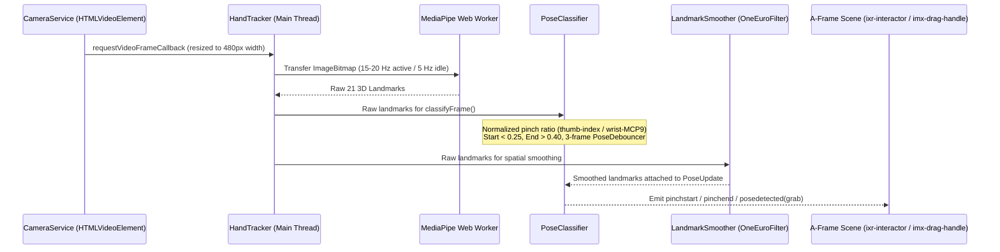
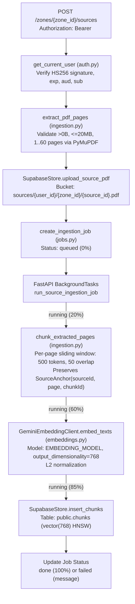

# System Architecture — IMAGGINAI

**Navigation:** [Root README (EN)](../README.md) | [README (pt-BR)](README.pt-BR.md) | [Contributing Guide](CONTRIBUTING.md) | [Specification](spec.md) | [Progress Log](PROGRESS.md)

This document describes the internal architecture of the three core packages implemented through Phase 6: `packages/interacxr`, `apps/web`, and `apps/api`.

---

## 1. InteracXR Hand Tracking and Stereo Passthrough (`packages/interacxr`)

`interacxr` is a standalone TypeScript library that provides rear-camera video passthrough, MediaPipe 3D hand landmark tracking, gesture classification, and A-Frame interaction adapters for mobile WebXR (`immersive-vr` sessions).

### 1.1 Single-Stream Camera and Unified Calibration

Mobile browsers restrict concurrent `getUserMedia` streams and incur high GPU overhead if video frames are decoded twice. `CameraService` opens a single `MediaStream` (`facingMode: "environment"`, ideal `1280x720`) and exposes one shared `HTMLVideoElement` consumed simultaneously by `PassthroughLayer` and `HandTracker`.

Both the video background plane and the 3D hand skeleton derive their dimensions from a single `CalibrationProfile` at a fixed head-locked distance $d = 1.0\text{ m}$ and vertical camera field of view $\text{camVFovDeg} = 50^\circ$:

$$h = 2 \cdot d \cdot \tan\left(\frac{\text{camVFovDeg}}{2}\right), \quad w = h \cdot \frac{\text{videoWidth}}{\text{videoHeight}}$$

For stereo comfort inside a VRBox/Cardboard lens system, `PassthroughLayer` renders dual per-eye planes (`eyeFillScale = 1.48`, stereo convergence offset `0.018` on Three.js camera layers `1` and `2`) while keeping the 3D hand projection anchored to the `1.0x` calibrated coordinate frame so virtual fingers align with the user's physical hand.

### 1.2 Dual-Stream Landmark Pipeline (Raw Classification vs. Smoothed Rendering)

A critical architectural invariant (verified by device replay tests in `packages/interacxr/src/core/pose-classifier.replay.test.ts`):

- **Gesture classification (`classifyFrame`) runs strictly on raw landmarks.** Fast natural pinches dip below the `0.25` threshold for only 3 to 5 frames (~150–250 ms at 19 Hz). Passing One-Euro-filtered coordinates into the classifier introduces phase lag that attenuates short dips and drops fast pinches.
- **Spatial rendering (`ixr-hand-model`, `ixr-cursor`, drag positions) uses `LandmarkSmoother` (`OneEuroFilter`).** This eliminates visual jitter without sacrificing gesture responsiveness.

---

## 2. Spatial Workspace Architecture (`apps/web/src/zone/`)

The XR Zone (`apps/web/zone.html`) is a pure A-Frame 1.7.1 application with zero React runtime overhead and zero network requests during a study session.

### 2.1 Spherical Coordinate System and Interaction Mapping

The user is seated at the rig origin `(0, 1.2, 0)`. Every spatial panel is positioned on a sphere around the rig using `{ yawDeg, pitchDeg, radiusM }`:

- **Full 360-degree placement:** `yawDeg` spans `[-180, 180]`, `pitchDeg` spans `[-80, 80]`, snapped to multiples of `10 degrees` on drop (`apps/web/src/zone/systems/spherical.ts`).
- **Discrete radii:** `radiusM` cycles across `{0.55, 0.75, 1.0, 1.5, 2.0}` meters (`+` brings the panel closer down to `0.55 m`; `-` pushes it farther up to `2.0 m`).
- **Spherical billboard tilt:** Panels rotate in both yaw (`panelFacingYawDeg`) and pitch (`panelFacingPitchDeg`) so high or low panels incline naturally toward the viewer's eyes instead of appearing stuck to a flat vertical wall.
- **Collision avoidance:** On drop, `resolvePanelPlacement` checks angular edge separation (`>= 5 degrees`) and shifts colliding panels to the nearest free `10-degree` slot.
- **Split gesture responsibilities:**
  - **Pinch (`ixr-interactor`):** Exclusively triggers discrete button clicks (PDF pagination, radius `-`/`+`, Belt Menu actions).
  - **Closed Fist (`grab` pose on `imx-drag-handle`):** Looking at the 6-dot handle above a panel and closing the hand grabs and moves the panel across the sphere; opening the hand drops and persists the layout to IndexedDB (`Dexie`).
- **Non-occluded hand and reticle:** `ixr-hand-model` (`renderOrder = 999`) and `ixr-cursor` (`renderOrder = 1000`) render with `depthTest: false` so panels brought close (`0.55 m`) never clip or hide the user's virtual hand.

### 2.2 Glassmorphism 3D Geometry and Theme System

Instead of sharp-cornered `<a-plane>` primitives, panels, buttons, drag handles, and the status pill use custom `rounded-rect` `THREE.ShapeGeometry` meshes (`apps/web/src/zone/systems/rounded-shape.ts`).

`apps/web/src/zone/systems/theme-controller.ts` manages two high-contrast spatial themes shared with the 2D web interface (`apps/web/src/app/styles/glass-theme.css`):

| Theme ID                | Surface Color & Opacity | Border & Interactive Feedback                                                               | Typography                       |
| :---------------------- | :---------------------- | :------------------------------------------------------------------------------------------ | :------------------------------- |
| `light-glass` (default) | `#F1F5F9` (`0.78`)      | Solid `#FFFFFF`; stroke thickens from `5 mm` to `14 mm` (`opacity 1.0`) on hover/click/grab | `#0F172A` title / `#1E293B` body |
| `dark-glass`            | `#0A0F1D` (`0.84`)      | Solid `#FFFFFF`; stroke thickens from `5 mm` to `14 mm` (`opacity 1.0`) on hover/click/grab | `#F8FAFC` title / `#E2E8F0` body |

When `passthrough` mode is active, `passthrough-shader.ts` applies a 5-tap Gaussian-style kernel (`uBlur = 1.0`) to the rear camera feed so the physical room appears softly defocused behind the translucent glass panels while maintaining 60 FPS on mobile GPUs. When `focus` mode is active, the environment uses a low-stimulus midnight charcoal palette (`#05070B` / `#090D14` / `#121824`).

### 2.3 Belt Menu Hysteresis (`imx-belt-menu`)

To prevent accidental activation while reading the bottom of a study card or PDF page:

- The Belt Menu opens only when camera pitch remains below `-30 degrees` continuously for `>= 400 ms`.
- While hidden, the belt's horizontal yaw smoothly follows the user's head (`circularLerpDeg`, `alpha = 0.1`).
- Once visible, horizontal yaw is **frozen** so the user can look left and right across the 7 arc buttons (`Sair`, `Zonas`, `Modo`, `Tema`, `Pomodoro`, `Recentrar`, `IA`) without the menu chasing their gaze.
- It hides when camera pitch rises above `-20 degrees`.

---

## 3. Backend API, Ingestion, and Vector Indexing (`apps/api`)

The FastAPI backend (`apps/api/app/`) handles authentication, Zone persistence, PDF validation, page-anchored text chunking, and 768-dimension vector embedding generation.

### 3.1 Repository Abstraction (`DatabaseStore`)

`apps/api/app/core/db.py` defines the `DatabaseStore` protocol with two implementations:

1. **`SupabaseStore`:** Production adapter using the `supabase` Python client to query PostgreSQL tables (`zones`, `sources`, `chunks`, `jobs`) and manage private objects in Supabase Storage (`sources` and `packs` buckets).
2. **`InMemoryStore`:** Deterministic in-memory adapter injected during `pytest` runs (`apps/api/tests/test_phase6_backend.py`) so every route, ownership check, cascade deletion, and background job transition is tested without external network calls.

### 3.2 Page-Boundary Invariant in Chunking

Every AI-generated item in IMAGGINAI must cite a verified `SourceAnchor` (`{ sourceId, page, chunkId }`). Therefore, `chunk_extracted_pages` (`apps/api/app/services/ingestion.py`) never concatenates text across page boundaries. Each page extracted by PyMuPDF is windowed independently into `500-token` segments with a `50-token` overlap, guaranteeing that every row in `public.chunks` maps to a single, exact 1-indexed PDF page.
