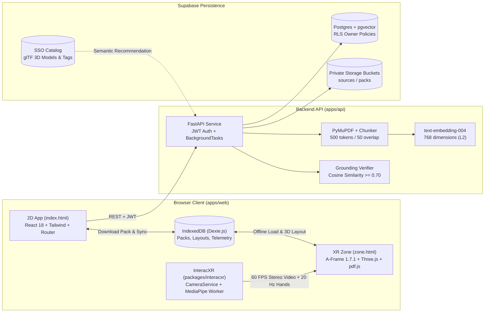

<p align="center">
  
</p>

# IMAGGINAI

**Language:** English | [Português (Brasil)](../README.md)

**Additional documentation:** [System Architecture](ARCHITECTURE.md) | [Contributing and Implementation Standards](CONTRIBUTING.md)

**IMAGGINAI** (*IMAGGI Navigable Augmented Intelligence*) is an accessible, low-cost hybrid WebXR (VR/AR) immersive learning ecosystem designed to run in smartphone browsers mounted inside passive headsets (such as VRBox or Google Cardboard). The platform converts static academic course materials (textbooks, lecture notes, and PDFs) into interactive 3D spatial environments through **Spatial RAG**, a proprietary computer-vision hand tracking library operating via the rear camera (**InteracXR**), **Special Study Objects (SSO)** anchored to original document citations, and privacy-preserving behavioral telemetry for university-level educational research.

---

## 1. System Overview (The Three Stages)

IMAGGINAI operates across three coordinated functional phases, strictly isolating cloud-based generative AI workflows from offline spatial study:

| Stage | Environment | Pedagogical & Technical Goal | Connectivity & AI Usage |
| :--- | :--- | :--- | :--- |
| **1. Prepare** | 2D Web App (`index.html`, React 18) | Creation of study Zones, multi-PDF upload, text ingestion, semantic vector embedding, 3D asset recommendation, and grounded hallucination filtering. | **Online** (FastAPI, Supabase pgvector, Gemini 1.5 Pro / Groq) |
| **2. Zone** | 3D Spatial Workspace (`zone.html`, A-Frame 1.7.1) | Immersive study session with 3D concept graphs, 360° animated Special Study Objects, spatial flashcards, active quizzes, sequencing minigames, and a synchronized PDF reader. | **100% Offline** (local cache via IndexedDB/Dexie; zero runtime LLM or network calls) |
| **3. Review** | 2D Web App (`/dashboard`, React 18) | **Student & Education Researcher Dashboard**: visualization of focus vs. passthrough time distribution, concept coverage, quiz retention accuracy, pinch biomechanics, and anonymized dataset export for university research. | **Local-first / Privacy** (aggregates synced only with explicit, informed research consent) |



---

## 2. Spatial Zone Interactive Resources

Within the 3D immersive Zone, learners interact with five types of spatial instructional assets grounded in their source documents:

1. **Special Study Objects (SSO) (`imx-special-study-object`):**
   * Pre-authored, animated 3D models in glTF 2.0 format (e.g., an anatomical Beating Heart with continuous skeletal simulation via `AnimationMixer`).
   * Free 360° rotation (Yaw/Pitch) using natural left- or right-hand pinch gestures via `ixr-rotatable`.
   * Spatial clinical markers (*hotspots*) designed with a dual-sphere technique (solid white core and high-contrast inverted-hull BackSide outline) with physiological occlusion in the Z-buffer.
   * Floating billboarding information card that constantly aligns to user gaze and features a **"View in PDF ↗"** button that synchronously turns the spatial PDF reader to the exact cited page (`ZONE_GOTO_PDF_PAGE_EVENT`).
   * Calibrated Mixed Reality optical stability: explicit rendering layers (`renderOrder`: video passthrough `-100`, 3D model `1`, hotspots `2`, info card `10`) and a dedicated 3-point studio lighting setup (Key, Fill, and Rim lights).

2. **3D Concept Graphs (`imx-concept-graph`):**
   * Spherical 3D topology of concepts and directional relationships generated by the AI extraction pipeline.
   * Direct gaze/pinch selection that opens deep-dive node analysis panels and highlights connected conceptual pathways.

3. **Interactive 3D Flashcards (`imx-card-panel`):**
   * Glassmorphism floating cards with dynamic reveal/hide mechanisms and spatial repositioning.
   * Direct anchors to page citations in the original PDF.

4. **Active Retention Quizzes (`imx-quiz-panel`):**
   * Multiple-choice questions embedded in the scene with 4 interactable alternatives and instant grounded pedagogical explanations.

5. **Sequence Ordering Minigame (`imx-sequence-asset`):**
   * Chronological ordering of multi-step processes (e.g., cardiac depolarization pathways, metabolic cycles, or circuit troubleshooting steps).

6. **Belt Menu & Productivity Tools (`imx-belt-menu`):**
   * Head-locked waist belt menu triggered by looking downward with angular hysteresis to prevent accidental openings while reading.
   * Instant category filters, theme switching (*dark-glass* vs. *light-glass*), **Focus (VR)** vs. **Passthrough (AR)** toggle, spatial Pomodoro timer, and dynamic panel recentering.

---

## 3. Technology Stack

| Layer | Technology | Role in Project |
| :--- | :--- | :--- |
| **Monorepo & Tooling** | `pnpm` (v10) + `uv` (Python 3.12) | Cross-platform dependency orchestration across TypeScript packages and the Python backend. |
| **2D Web Application** | Vite 8, React 18, React Router 7, Tailwind CSS, TypeScript 6 (`strict`) | Setup wizard, study pack review, user authentication, and analytics dashboard. |
| **WebXR Spatial Workspace** | A-Frame 1.7.1, Three.js r173, `aframe-troika-text`, `pdfjs-dist` | Stereo WebXR rendering, crisp SDF typography, sliding-window PDF canvas textures, and custom rounded 3D glass geometry. |
| **Computer Vision & Tracking** | `interacxr`, `@mediapipe/tasks-vision` (1.1.0) | Single rear camera stream, Web Worker hand landmark inference, OneEuroFilter, and stereo passthrough shaders. |
| **Local Client Storage** | Dexie 4 (IndexedDB) | Offline client storage for Study Packs, spherical layouts, Pomodoro state, and local telemetry events. |
| **Backend API** | FastAPI, Pydantic v2, `pydantic-settings`, `PyJWT` | Asynchronous REST endpoints, Supabase JWT verification, and background job extraction. |
| **PDF & AI Pipeline** | `pymupdf`, `google-genai`, Groq, `networkx` | Page-by-page text extraction, anchored chunking, 768-dim embeddings, grounded Study Pack generation, and Grounding Verifier ($\ge 0.70$). |
| **Database & Cloud Storage** | Supabase (PostgreSQL, `pgvector` HNSW, Storage, Auth) | Multi-tenant isolation with Row-Level Security (RLS) for zones, vector chunks, study packs, and research session aggregates. |
| **Testing & Quality** | Vitest, Pytest, ESLint 10, Prettier, Ruff | Comprehensive unit tests, deterministic landmark replay, and TypeScript/Python schema parity. |

---

## 4. Repository Structure

```text
imagginai/
├─ apps/
│  ├─ web/                        # Multi-page Vite web application
│  │  ├─ index.html               # 2D entry point (Prepare / Review)
│  │  ├─ zone.html                # 3D WebXR entry point (plain A-Frame)
│  │  ├─ public/
│  │  │  ├─ mediapipe/            # MediaPipe WASM and hand_landmarker.task model
│  │  │  ├─ models/               # 3D models in glTF/GLB (e.g. beating_heart_3d.glb)
│  │  │  └─ demo-packs/           # Seeded demo packs for testing
│  │  └─ src/
│  │     ├─ app/                  # React pages (Home, Zones, Dashboard, SSO Admin)
│  │     ├─ zone/                 # A-Frame components (imx-*) and pure spatial systems
│  │     └─ shared/               # StudyPack validator, Dexie DB, Three.js helpers, i18n
│  └─ api/                        # FastAPI backend managed by uv
│     ├─ app/
│     │  ├─ core/                 # Configuration, JWT auth, and database abstraction
│     │  ├─ routers/              # REST endpoints (/health, /zones, /jobs, /telemetry)
│     │  ├─ schemas/              # Pydantic models mirrored from TypeScript
│     │  └─ services/             # PyMuPDF ingestion, embeddings, pack generation, grounding
│     ├─ scripts/run-uv.mjs       # Cross-platform uv executable locator
│     └─ tests/                   # Pytest test suite with mocked providers
├─ packages/
│  └─ interacxr/                  # Proprietary WebXR hand-tracking and passthrough library
│     ├─ src/
│     │  ├─ core/                 # CameraService, HandTracker, OneEuroFilter, PoseClassifier
│     │  ├─ calibration/          # FOV calibration profile and stereo projection
│     │  ├─ passthrough/          # Head-locked video plane with 5-tap background blur
│     │  ├─ telemetry/            # Typed synchronous TelemetryBus
│     │  ├─ replay/               # Deterministic landmark recorder and replay player
│     │  └─ aframe/               # A-Frame component adapters (ixr-*)
│     └─ examples/basic/          # Standalone Vite example for device regression checks
├─ fixtures/
│  ├─ demo-pack.json              # Reference StudyPack with integrated SSO (Cardiovascular)
│  ├─ demo-pdfs/                  # Sample academic PDFs
│  └─ landmark-sessions/          # Landmark sessions recorded on physical mobile devices
├─ supabase/migrations/
│  └─ 0001_init.sql               # PostgreSQL schema, pgvector HNSW index, RLS policies
└─ docs/
   ├─ logo imagginai.png          # Official brand identity
   ├─ ARCHITECTURE.md             # In-depth architectural patterns and data flows
   ├─ CONTRIBUTING.md             # Code conventions and contribution guidelines
   └─ README.en.md                # This English documentation
```

---

## 5. Local Development Setup

### Prerequisites

* **Node.js** 22+ and **pnpm** 10+
* **Python** 3.11 or 3.12 and **uv**

### 1. Install Dependencies

```bash
# Install JavaScript/TypeScript workspace dependencies
pnpm install

# Synchronize Python virtual environment and API dependencies
cd apps/api && uv sync && cd ../..
```

### 2. Configure Environment Variables

Copy `.env.example` to `.env` in the root directory:

```bash
cp .env.example .env
```

| Variable | Scope | Description |
| :--- | :--- | :--- |
| `SUPABASE_URL` | API | Supabase project URL (`https://<id>.supabase.co`). |
| `SUPABASE_SERVICE_ROLE_KEY` | API | Secret `service_role` key (backend use only). |
| `SUPABASE_JWT_SECRET` | API | JWT secret key for token verification. |
| `GEMINI_API_KEY` | API | Google Gemini API key for embeddings and pack extraction. |
| `EMBEDDING_MODEL` | API | Embedding model name (`text-embedding-004`). |
| `LLM_MODEL` | API | Primary generation model (`gemini-1.5-pro` or `gemini-2.5-flash`). |
| `GROQ_API_KEY` | API | Groq API key for Llama 3.3 contingency fallback. |
| `FALLBACK_LLM_MODEL` | API | Contingency model name (`llama-3.3-70b-versatile`). |
| `CORS_ORIGINS` | API | Allowed CORS origins (default: `http://localhost:5173`). |
| `VITE_SUPABASE_URL` | Web | Public Supabase project URL for the web client. |
| `VITE_SUPABASE_ANON_KEY` | Web | Public `anon` key from Supabase. |
| `VITE_API_BASE_URL` | Web | FastAPI server base URL (`http://localhost:8000`). |

To apply database tables and storage policies, open the Supabase **SQL Editor**, paste the contents of [`supabase/migrations/0001_init.sql`](../supabase/migrations/0001_init.sql), and run the query.

### 3. Development Commands

| Command | Description |
| :--- | :--- |
| `pnpm dev` | Starts Vite dev server at `http://localhost:5173` (`/` and `/zone.html`). |
| `pnpm dev:https` | Starts dev server with HTTPS for testing WebXR and camera on physical mobile devices. |
| `pnpm dev:api` | Starts FastAPI server at `http://localhost:8000` (interactive docs at `/docs`). |
| `pnpm test` | Runs the full automated test suite (`interacxr`, `apps/web`, and `apps/api`). |
| `pnpm lint` | Runs TypeScript type checking (`tsc`), ESLint, and Ruff. |
| `pnpm build` | Builds the `interacxr` library and produces production bundles for `apps/web`. |

> **Note:** All automated tests (`pnpm test`) use deterministic mocks and succeed without requiring live API keys in `.env`.

---

## 6. Cloud Deployment (Free Tier)

This repository includes deployment configurations for popular free-tier cloud platforms:

* **Frontend Web (`vercel.json`):** Deploy to Vercel with automatic HTTPS, PWA route redirects, and immutable cache headers for MediaPipe assets.
* **Backend API (`apps/api/Dockerfile` and `render.yaml`):** Deploy to Render as a Python Web Service with `uv` orchestration.
* **Supabase Keep-Alive (`.github/workflows/supabase-keepalive.yml`):** Automated GitHub Action every 5 days to prevent free-tier project pausing.

---

## 7. License

This project and the internal `interacxr` package are released under the **MIT License**. See [`packages/interacxr/LICENSE`](../packages/interacxr/LICENSE) for details.
