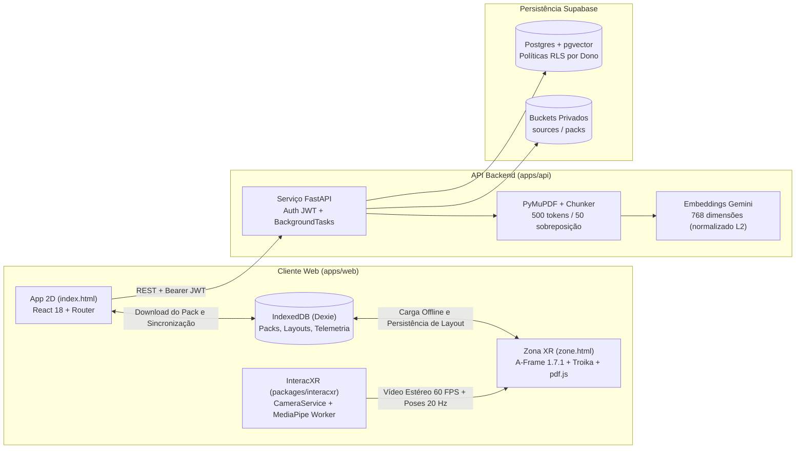

# IMAGGINAI (Português)

**Idioma:** [English](../README.md) | Português (Brasil)

**Documentação complementar:** [Arquitetura do Sistema](ARCHITECTURE.md) | [Guia de Contribuição e Padrões de Código](CONTRIBUTING.md)

O IMAGGINAI (_IMAGGI Navigable Augmented Intelligence_) é um ambiente de estudo híbrido em WebXR (VR/AR) de baixo custo, projetado para rodar no navegador de smartphones acoplados a óculos passivos (VRBox ou Google Cardboard). O sistema combina mira pelo movimento da cabeça (_head-gaze_), rastreamento 3D das mãos pela câmera traseira por meio da biblioteca própria (`interacxr`) e um espaço de trabalho tridimensional 100% offline onde o estudante interage com materiais gerados e verificados por IA.

---

## 1. Visão Geral do Sistema

A plataforma é dividida em três estágios operacionais com fronteiras estritas entre a preparação online com IA e o estudo espacial offline:

| Estágio     | Ambiente                                        | Objetivo                                                                                                                                                                                                | Rede e Uso de IA                                                                            |
| :---------- | :---------------------------------------------- | :------------------------------------------------------------------------------------------------------------------------------------------------------------------------------------------------------ | :------------------------------------------------------------------------------------------ |
| **Prepare** | Aplicação Web 2D (`index.html`, React 18)       | Criar Zonas de estudo, enviar arquivos PDF, acompanhar jobs de ingestão e geração do Study Pack, revisar conceitos extraídos.                                                                           | Online (FastAPI, Supabase, Gemini, Groq)                                                    |
| **Zone**    | Espaço Espacial 3D (`zone.html`, A-Frame 1.7.1) | Sessão de estudo imersivo com flashcards 3D interativos (`Revelar` / `Ocultar`), leitor de PDF multipágina, grafos de conceitos 3D, timer Pomodoro e câmera passthrough estereoscópica.                 | 100% Offline (lê do IndexedDB via Dexie; zero chamadas de rede ou LLM)                      |
| **Review**  | Aplicação Web 2D (`/dashboard`, React 18)       | **Painel do Estudante e Pesquisador** (tempo de foco, cobertura conceitual, acurácia em quizzes por conceito, biomecânica de pinça, exportação anônima JSON/CSV e controles LGPD de exclusão de dados). | Local-first (envia agregados de sessão apenas se o consentimento de pesquisa estiver ativo) |



---

## 2. Stack Tecnológica

| Camada                                 | Tecnologia                                                        | Papel no Projeto                                                                                                                                       |
| :------------------------------------- | :---------------------------------------------------------------- | :----------------------------------------------------------------------------------------------------------------------------------------------------- |
| **Monorepo e Gerenciamento**           | `pnpm` (v10) + `uv` (Python 3.12)                                 | Orquestração de pacotes TypeScript e do ambiente virtual Python.                                                                                       |
| **Aplicação Web 2D**                   | Vite 8, React 18, React Router 7, TypeScript 6 (`strict`)         | Preparação de zonas, autenticação, monitoramento de upload de PDF e revisão de métricas.                                                               |
| **Espaço Espacial XR**                 | A-Frame 1.7.1 (Three.js r173), `aframe-troika-text`, `pdfjs-dist` | Renderização estereoscópica WebXR, tipografia SDF de alta nitidez, texturas de PDF com janela deslizante e geometria 3D arredondada em vidro.          |
| **Rastreamento de Mãos e Passthrough** | `interacxr`, `@mediapipe/tasks-vision` (1.1.0)                    | Captura unificada da câmera traseira, inferência de mãos em Web Worker, filtro One Euro e shaders de passthrough estereoscópico com desfoque de fundo. |
| **Persistência Local**                 | Dexie 4 (IndexedDB)                                               | Armazenamento offline de Study Packs, layouts esféricos de painéis, estado de sessão Pomodoro e eventos locais de telemetria.                          |
| **API Backend**                        | FastAPI, Pydantic v2, `pydantic-settings`, `PyJWT`                | Endpoints REST stateless, validação de JWT do Supabase e execução de tarefas em segundo plano.                                                         |
| **Pipeline de PDF e IA**               | `pymupdf`, `google-genai`, Groq, `networkx`                       | Extração textual por página, divisão em trechos com âncoras, embeddings de 768 dimensões, geração verificada de Study Packs e layout 3D de grafos.     |
| **Banco de Dados e Storage**           | Supabase (PostgreSQL, `pgvector` HNSW, Storage, Auth)             | Persistência multiusuário com Row-Level Security (RLS) para zonas, fontes, trechos vetoriais, pacotes, jobs e agregados de sessão.                     |
| **Qualidade e Testes**                 | Vitest, Pytest, ESLint 10, Prettier, Ruff                         | Testes unitários, replay determinístico de gestos, paridade de esquemas e testes de integração com provedores simulados.                               |

---

## 3. Estrutura do Repositório

```text
imagginai/
├─ apps/
│  ├─ web/                        # Aplicação Vite multipágina
│  │  ├─ index.html               # Entrada 2D (Prepare / Review)
│  │  ├─ zone.html                # Entrada 3D WebXR (A-Frame puro, sem React)
│  │  ├─ public/mediapipe/        # Arquivos WASM do MediaPipe e modelo hand_landmarker.task
│  │  └─ src/
│  │     ├─ app/                  # Páginas React, componentes e estilos glass-theme
│  │     ├─ zone/                 # Componentes A-Frame (imx-*) e sistemas espaciais puros
│  │     └─ shared/               # Validador de StudyPack, banco Dexie, i18n (pt-BR), logger
│  └─ api/                        # Backend FastAPI gerenciado via uv
│     ├─ app/
│     │  ├─ core/                 # Configurações (config.py), auth JWT (auth.py), store (db.py)
│     │  ├─ routers/              # Rotas REST (/health, /zones, /jobs)
│     │  ├─ schemas/              # Modelos Pydantic (study_pack.py, zones.py, jobs.py)
│     │  └─ services/             # Ingestão PyMuPDF, embeddings de 768 dim e jobs assíncronos
│     ├─ scripts/run-uv.mjs       # Localizador multiplataforma do binário uv
│     └─ tests/                   # Suíte Pytest com provedores simulados e InMemoryStore
├─ packages/
│  └─ interacxr/                  # Biblioteca própria de rastreamento de mãos e passthrough WebXR
│     ├─ src/
│     │  ├─ core/                 # CameraService, HandTracker, OneEuroFilter, PoseClassifier
│     │  ├─ calibration/          # Perfil unificado de calibração por FOV
│     │  ├─ passthrough/          # Plano de vídeo acoplado à cabeça e shader de blur de 5 taps
│     │  ├─ telemetry/            # Barramento tipado TelemetryBus
│     │  ├─ replay/               # Gravador e reprodutor determinístico de sessões de landmarks
│     │  └─ aframe/               # Adaptadores de componentes A-Frame (ixr-*)
│     └─ examples/basic/          # Exemplo independente em Vite para testes de regressão
├─ fixtures/
│  ├─ demo-pack.json              # StudyPack de referência (sistema cardiovascular, pt-BR)
│  ├─ study-pack-invalid-cases.json # 27 casos inválidos compartilhados (paridade TS + Python)
│  └─ landmark-sessions/          # Sessões de landmarks sintéticas e gravadas em dispositivo real
├─ supabase/migrations/
│  └─ 0001_init.sql               # Esquema PostgreSQL, índice HNSW pgvector, RLS e políticas de Storage
└─ docs/
   ├─ ARCHITECTURE.md             # Detalhamento profundo da arquitetura e fluxos de dados
   ├─ CONTRIBUTING.md             # Padrões de implementação e exemplos práticos de código
   └─ README.pt-BR.md             # Esta documentação em português
```

---

## 4. Configuração do Ambiente Local

### Pré-requisitos

- **Node.js** 22+ e **pnpm** 10+
- **Python** 3.11 ou 3.12 e **uv**

### 1. Instalar Dependências

```bash
# Instala os pacotes JavaScript/TypeScript dos workspaces
pnpm install

# Sincroniza o ambiente virtual Python e instala as dependências da API
cd apps/api && uv sync && cd ../..
```

### 2. Configurar Variáveis de Ambiente

Copie o arquivo `.env.example` para `.env` na raiz do repositório e preencha as credenciais:

```bash
cp .env.example .env
```

| Variável                    | Escopo | Descrição                                                                                 |
| :-------------------------- | :----- | :---------------------------------------------------------------------------------------- |
| `SUPABASE_URL`              | API    | URL do projeto em Supabase Settings -> Data API (`https://<id>.supabase.co`).             |
| `SUPABASE_SERVICE_ROLE_KEY` | API    | Chave secreta `service_role` em Supabase Settings -> API Keys (uso exclusivo no backend). |
| `SUPABASE_JWT_SECRET`       | API    | Segredo de assinatura JWT em Supabase Settings -> JWT Keys.                               |
| `GEMINI_API_KEY`            | API    | Chave do Google AI Studio usada para embeddings e extração do Study Pack.                 |
| `EMBEDDING_MODEL`           | API    | Nome do modelo de embeddings Gemini (ex.: `gemini-embedding-001`).                        |
| `LLM_MODEL`                 | API    | Modelo principal de geração Gemini (ex.: `gemini-2.5-flash`).                             |
| `GROQ_API_KEY`              | API    | Chave da API Groq usada como provedor reserva na Fase 7+.                                 |
| `FALLBACK_LLM_MODEL`        | API    | Nome do modelo reserva na Groq (ex.: `llama-3.3-70b-versatile`).                          |
| `CORS_ORIGINS`              | API    | Origens permitidas separadas por vírgula (padrão: `http://localhost:5173`).               |
| `VITE_SUPABASE_URL`         | Web    | Mesma URL do projeto Supabase exposta para o cliente web.                                 |
| `VITE_SUPABASE_ANON_KEY`    | Web    | Chave pública `anon` em Supabase Settings -> API Keys.                                    |
| `VITE_API_BASE_URL`         | Web    | URL base do servidor FastAPI (padrão: `http://localhost:8000`).                           |

Para criar as tabelas e buckets no Supabase, abra o **SQL Editor** no painel do Supabase, cole o conteúdo de [`supabase/migrations/0001_init.sql`](../supabase/migrations/0001_init.sql) e execute a query.

### 3. Comandos Principais

| Comando          | Descrição                                                                                                          |
| :--------------- | :----------------------------------------------------------------------------------------------------------------- |
| `pnpm dev`       | Inicia o servidor Vite em `http://localhost:5173` (`/index.html` e `/zone.html`).                                  |
| `pnpm dev:https` | Inicia o servidor Vite com HTTPS (`https://<ip-da-rede>:5173`) para testes de WebXR e câmera no celular.           |
| `pnpm dev:api`   | Inicia o servidor FastAPI em `http://localhost:8000` (documentação interativa em `/docs`).                         |
| `pnpm lint`      | Executa ESLint, Prettier, verificação de tipos TypeScript (`tsc`) e Ruff (lint + formatação Python).               |
| `pnpm test`      | Executa todos os testes automatizados em `packages/interacxr` (Vitest), `apps/web` (Vitest) e `apps/api` (Pytest). |
| `pnpm build`     | Compila a biblioteca `interacxr`, gera os pacotes de produção do `apps/web` e valida o bytecode Python.            |

> **Observação:** Todos os testes automatizados (`pnpm test`) simulam provedores externos e passam de forma determinística mesmo sem credenciais preenchidas no `.env`.

---

## 5. Implantação em Nuvem (Free Tier)

O repositório inclui os arquivos de configuração prontos para publicação em camadas gratuitas:

- **Frontend (`vercel.json`):** Conecte o repositório na Vercel (Root Directory: `.`). A Vercel executa `pnpm --filter @imagginai/web build`, publica `apps/web/dist` com HTTPS (obrigatório para WebXR e câmera), aplica cache imutável em `/mediapipe/*` e `/pdfjs/*` e direciona as rotas 2D (`/`, `/zones/:id`, `/dashboard`) para `/index.html`, preservando `/zone.html` independente.
- **API Backend (`apps/api/Dockerfile` e `render.yaml`):** Conecte o repositório ao Render Blueprints (ou faça deploy direto do `apps/api/Dockerfile`). Configure `SUPABASE_URL`, `SUPABASE_SERVICE_ROLE_KEY`, `SUPABASE_JWT_SECRET`, `GEMINI_API_KEY`, `GROQ_API_KEY` e `CORS_ORIGINS` no painel do Render.
- **Keep-Alive do Supabase (`.github/workflows/supabase-keepalive.yml`):** GitHub Action agendada a cada 5 dias (`0 8 */5 * *`) para evitar a pausa por inatividade do plano gratuito do Supabase. Adicione `SUPABASE_URL` e `SUPABASE_ANON_KEY` nos Secrets do GitHub.

---

## 6. Resumo dos Padrões de Código

O repositório aplica regras estritas de padronização em TypeScript e Python (detalhadas com exemplos práticos em [`docs/CONTRIBUTING.md`](CONTRIBUTING.md)):

- **Identificadores em Inglês:** Todas as variáveis, funções, classes, tipos, arquivos e pastas devem ser nomeados em inglês (`kebab-case` para arquivos, `PascalCase` para classes e tipos, `camelCase` em TypeScript, `snake_case` em Python e `UPPER_SNAKE_CASE` para constantes).
- **Comentários em Português, Minúsculos e Impessoais:** Todo comentário, JSDoc e docstring Python deve ser escrito em português, usando exclusivamente letras minúsculas (inclusive a primeira letra) e verbos na forma impessoal ou voz passiva sintética (ex.: `// calcula a posição esférica do painel`, `# valida a assinatura do token jwt`). É proibido usar primeira ou segunda pessoa.
- **Separação de Lógica Pura:** Cálculos geométricos, máquinas de estado e transformações de dados ficam isolados em módulos puros sem importação de DOM, A-Frame ou clientes de rede, permitindo testes unitários diretos.
- **Ausência de Números Mágicos:** Limites espaciais, temporais, estruturais e de upload ficam centralizados em [`apps/web/src/zone/config/constants.ts`](../apps/web/src/zone/config/constants.ts) e [`apps/api/app/core/config.py`](../apps/api/app/core/config.py).

---

## 7. Licença

Este projeto e o pacote interno `interacxr` são distribuídos sob a licença MIT. Consulte [`packages/interacxr/LICENSE`](../packages/interacxr/LICENSE) para mais detalhes.
